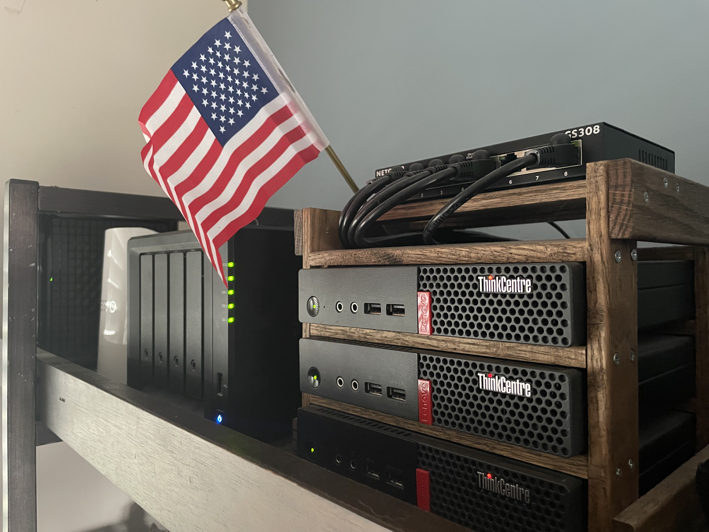
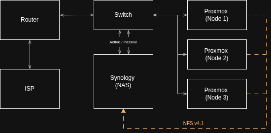
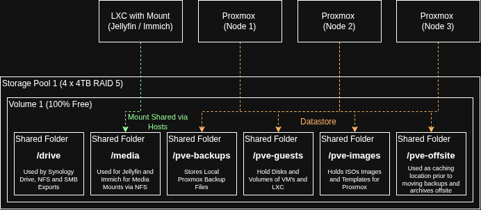
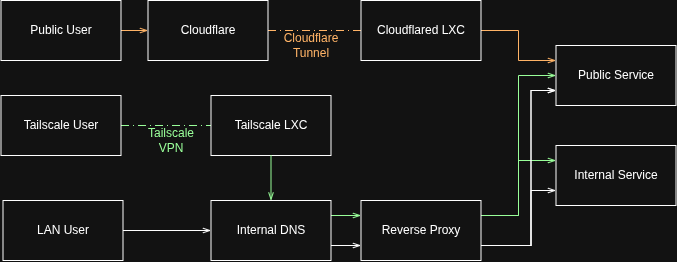
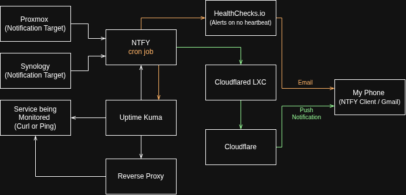
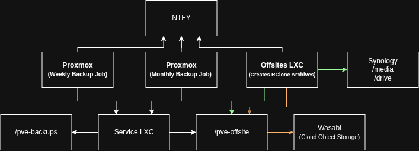

# Home Infrastructure

> A 3-node Proxmox HA cluster running 17 self-hosted services for my family and my wife's small business, with zero open inbound ports, 3-2-1 backups and end-to-end monitoring.

<!-- Previous full-width version:  -->

## At a Glance

|                                       |                                                         |
|---------------------------------------|---------------------------------------------------------|
| **[Compute](#compute--storage)**      | 3-node Proxmox VE cluster with HA failover              |
| **[Storage](#compute--storage)**      | Synology NAS, 12 TB usable, NFS-backed datastores       |
| **[Services](#services)**             | 17 self-hosted apps (media, passwords, photos, DNS)     |
| **[Backups](#backup--recovery)**      | 3-2-1: weekly local, monthly encrypted offsite          |
| **[Access](#networking--access)**     | Zero open inbound ports, Cloudflare Tunnel & Tailscale  |
| **[Alerting](#monitoring--alerting)** | Push notifications via ntfy, email via Healthchecks.io  |
| **[Patching](#updates--patching)**    | Daily auto-updates for public services, rolling Proxmox upgrades |
| **[Evolution](#how-it-evolved)**      | Single Docker host → k3s cluster built as IaC → Proxmox HA with LXC |

## Why I Built It

- **Privacy:** block trackers and enforce DNS over TLS/HTTPS
- **Ownership:** back up family photos, files and media on hardware I control
- **Parental control:** choose what content my young kids can watch
- **Predictable costs:** run my wife's business without pay-as-you-go cloud billing

---

## Architecture

| Type    | Role         | Model                  | Notes                |
|---------|--------------|------------------------|----------------------|
| Compute | Proxmox Node | ThinkCentre M710q Tiny | Intel i5 / 16GB DDR4 |
| Compute | Proxmox Node | ThinkCentre M710q Tiny | Intel i5 / 16GB DDR4 |
| Compute | Proxmox Node | ThinkCentre M710q Tiny | Intel i5 / 16GB DDR4 |
| Storage | NAS          | Synology DS418         | 4x 4TB, RAID 5       |
| Network | Switch       | Netgear GS308          | 8-port unmanaged     |
| Network | Router       | eero Pro 7             | ISP provided         |

## Compute & Storage

Services run as LXC containers on a 3-node Proxmox cluster. Their disks live on a shared NFS datastore, so Proxmox HA can restart them on another node if one fails. Sidecar services run as separate Docker containers inside the same LXC as the service they support.

The NAS is split into purpose-specific shares. Services with large media libraries use dedicated mounts, which keeps guest backups small and lets that data follow its own backup schedule ([Backup & Recovery](#backup--recovery)).

**Known gaps**

| Gap                           | Impact                                  | Plan                                                          |
|-------------------------------|-----------------------------------------|---------------------------------------------------------------|
| No UPS                        | A power blip takes everything down hard | UPS with graceful shutdown                                    |
| NAS is a single storage point | NAS failure stops all HA guests         | Accepted risk; RAID 5 covers one disk, backups cover the rest |

## Networking & Access

Internal DNS resolves `*.kscheuer.com` to a reverse proxy, which terminates TLS and forwards traffic to the LXC containers. Most services are only reachable from the LAN or over Tailscale. The only public services are my wife's website and API, plus ntfy so alerts reach my phone off the LAN. These go through Cloudflare Tunnel straight to their LXC, bypassing internal DNS and the reverse proxy, with TLS terminated at Cloudflare's edge.

**Known gaps**

| Gap                            | Impact                                         | Plan                              |
|--------------------------------|------------------------------------------------|-----------------------------------|
| Flat network, no VLANs         | No isolation between services and home devices | VLANs when the switch is replaced |
| Unmanaged switch, single links | The switch is a single point of failure        | Managed switch with LACP          |

## Monitoring & Alerting

- **Hosts and NAS:** Proxmox and Synology send all notifications to ntfy, which pushes them to my phone.
- **Services:** Uptime Kuma checks each service's HTTP status code and response content, and pushes an alert to my phone when one fails. Public services are checked by their public hostnames, so each check runs end to end through external DNS, Cloudflare and the tunnel.
- **Dead man's switch:** a cron job on the ntfy LXC runs every minute. It checks that ntfy accepts a post to a dummy `/hc-check` topic and that Uptime Kuma responds, then pings Healthchecks.io. A failed check sends a failure ping, and if pings stop for longer than the 3-minute grace period, Healthchecks.io emails me. Email keeps this path independent of anything in the lab, so I still hear about it if ntfy, Uptime Kuma or the whole lab goes down.

**Known gaps**

| Gap                                     | Impact                                     | Plan                                             |
|-----------------------------------------|--------------------------------------------|--------------------------------------------------|
| Monitoring runs on the same NFS storage | A NAS outage takes ntfy and Uptime Kuma down | Accepted risk; Healthchecks.io still emails me |

## Backup & Recovery

**Strategy:** 3-2-1, with production data, a local backup on the NAS, and an encrypted offsite copy in Wasabi.

**Break-glass:** a printed page kept offline holds everything needed to rebuild if Vaultwarden is lost, including rclone passwords and salts, SSH keys, IPs and admin credentials.

- **Local:** Proxmox backs up every container weekly to the `pve-backups` share and keeps the last 4.
- **Offsite staging:** each month, Proxmox backs up every container to the `pve-offsite` share, and an offsite LXC builds rclone archives of the Immich and Synology Drive shares alongside them.
- **Offsite upload:** the offsite LXC then moves everything in `pve-offsite` to Wasabi. Data is encrypted by rclone before upload, locked against deletion for 90 days with object lock, and expired by a lifecycle policy after 90 days.

| Data                   | Frequency | Location                    | Retention |
|------------------------|-----------|-----------------------------|-----------|
| Proxmox guests         | Weekly    | NAS (`pve-backups`)         | Last 4    |
| Proxmox guests         | Monthly   | Wasabi (encrypted, locked)  | 90 days   |
| Photos (Immich)        | Monthly   | Wasabi (encrypted, locked)  | 90 days   |
| Files (Synology Drive) | Monthly   | Wasabi (encrypted, locked)  | 90 days   |

Jellyfin media is not backed up, since it can be re-downloaded.

**Why monthly offsite:** offsite is for the worst case, where the house or NAS is lost or ransomware hits. Losing up to a month of data in that case is acceptable, and it keeps offsite storage under 1 TB for cost reasons. If an upload would cross 1 TB, the job fails and notifies me instead. Archives are built on the 1st and uploaded on the 2nd, so either step can be re-run by itself.

## Updates & Patching

Public services update themselves daily, both OS packages and container images. An update could break something, but that's a risk I accept to keep admin overhead low, and Uptime Kuma alerts me if it happens. Everything else is updated from scripts on my workstation.

| Layer                                  | Method                                                                                           | Cadence                    |
|----------------------------------------|--------------------------------------------------------------------------------------------------|----------------------------|
| Public services (website, API, ntfy)   | Cron runs `apt upgrade` and pulls the latest container images                                    | Daily                      |
| Other LXCs: OS                         | Script runs `apt upgrade` on each LXC                                                            | Ad hoc                     |
| Other LXCs: containers                 | Diun notifies me of new images; a script pulls them and restarts only containers that changed    | When Diun notifies         |
| Proxmox hosts                          | Rolling script: one node at a time, enter maintenance mode, confirm guests migrated, `apt full-upgrade`, reboot, exit maintenance mode | Ad hoc |
| NAS (DSM)                              | Manual, after reading the release notes                                                          | As released                |

## Services

Everything is LAN or Tailscale only unless marked public.

| Category   | Service      | Purpose                                | Exposure            |
|------------|--------------|----------------------------------------|---------------------|
| Business   | moonlightweb | My wife's business website             | Public (Cloudflare) |
| Business   | moonlightapi | My wife's business backend: external API, internal API and database. The APIs listen on separate ports | External API only (Cloudflare) |
| Family     | Immich       | Photo and video backup                 | LAN / Tailscale     |
| Family     | Jellyfin     | Media streaming                        | LAN / Tailscale     |
| Family     | Mealie       | Recipes and meal planning              | LAN / Tailscale     |
| Media      | Tdarr        | Media transcoding                      | LAN / Tailscale     |
| Media      | qBittorrent  | Downloads                              | LAN / Tailscale     |
| Network    | AdGuard Home | Internal DNS and ad/tracker blocking. Enforce DNS over TLS/HTTPS | LAN / Tailscale     |
| Network    | Traefik      | Reverse proxy and TLS termination      | LAN / Tailscale     |
| Network    | cloudflared  | Cloudflare Tunnel endpoint             | Outbound only       |
| Network    | Tailscale    | Remote access to the LAN               | Tailnet             |
| Security   | Vaultwarden  | Password manager                       | LAN / Tailscale     |
| Operations | Uptime Kuma  | Service monitoring                     | LAN / Tailscale     |
| Operations | ntfy         | Push notifications                     | Public (Cloudflare) |
| Operations | Diun         | Container image update notifications   | LAN / Tailscale     |
| Operations | Homepage     | Dashboard for all services             | LAN / Tailscale     |
| Operations | offsites     | Builds and uploads offsite backups     | LAN / Tailscale     |

---

## How It Evolved

| Version | Design                                                                                     | Why it changed                                      |
|---------|--------------------------------------------------------------------------------------------|-----------------------------------------------------|
| v1      | Single Rocky Linux host, Docker Compose, Caddy                                              | No redundancy                                       |
| v2      | k3s on Proxmox (3 control-plane, 3 worker VMs), built with Ansible, Terraform, Helm, MetalLB | More upkeep and resources than the services needed |
| v3      | Proxmox HA with LXC containers on NFS shared storage                                       | Current design                                      |

- **v1** was my first home lab. Once I was hooked, I started building v2.
- **v2** was fully infrastructure as code, but it was overkill. I didn't need multiple replicas of any service or that level of HA, and it cost more admin time and server resources than it was worth.
- **v3** runs services in LXC containers with their disks on NFS, so Proxmox HA can restart them on another node and CRS can rebalance load across nodes. A failover means under a minute of downtime for the affected service. That's a trade I'm happy to make for how much easier it is to maintain, troubleshoot and back up.

**What I learned:** match the complexity to the actual requirements, not to what's possible.

## Roadmap

- [ ] UPS with graceful shutdown
- [ ] Managed switch and VLAN segmentation
