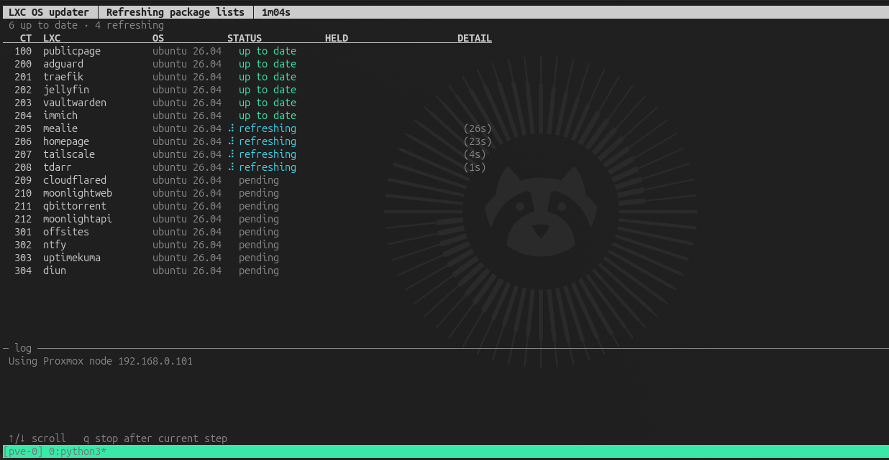
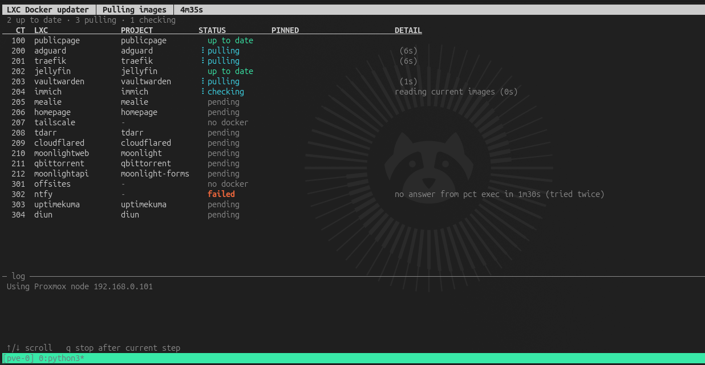
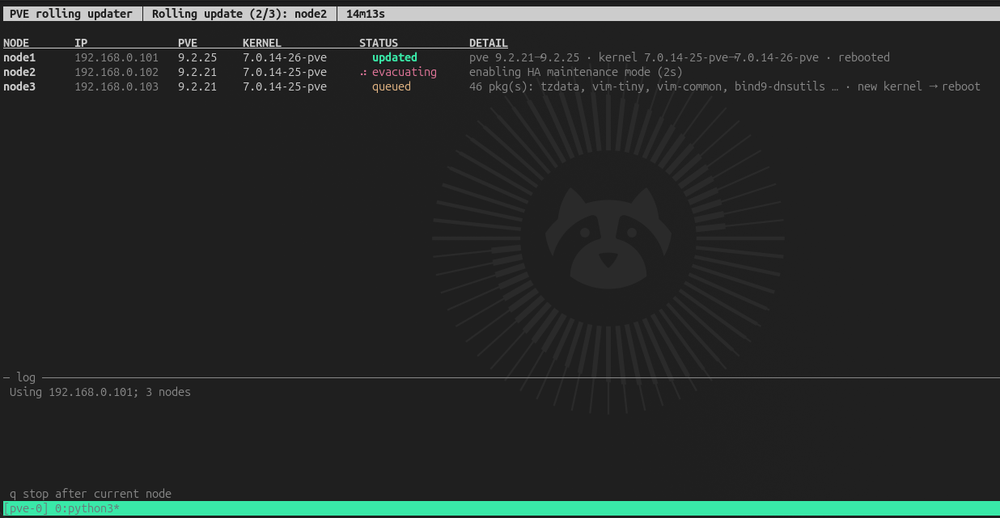

# Proxmox Update Scripts

> Three Python scripts that patch a Proxmox cluster from a workstation: LXC OS packages, Docker images inside LXCs, and the Proxmox nodes themselves, each with a live terminal UI.

## Setup

```bash
cp .env.example .env    # fill in PVE_NODES, SSH_USER, SSH_KEY
./lxc-os-updater.py --check-only
```

- **Requirements:** Python 3.9+ on the machine running the scripts. No pip packages needed.
- **SSH user:** needs key-based login and passwordless sudo on every node, which in practice means root-level access. If you use `root`, sudo is skipped automatically.
- **Host keys:** the scripts never prompt, so SSH to each node once by hand first, or set `SSH_STRICT_HOST_KEY_CHECKING=accept-new`.
- **Logs:** every run writes a full log to `logs/` (change with `UPDATER_LOG_DIR`).
- **Controls:** ↑/↓ scroll, `q` stops after the current step, Ctrl-C twice aborts.

All settings live in `.env`; see [.env.example](.env.example) for every option and its default.

---

## lxc-os-updater.py

Runs `apt` or `apk` upgrades on every running LXC in the cluster. Package lists and downloads happen in parallel up front, so installs work from the local cache even while DNS is down. CTs running Docker aren't marked done until the same number of containers are back up.



```bash
./lxc-os-updater.py                  # refresh + upgrade
./lxc-os-updater.py --check-only     # list pending upgrades, change nothing
./lxc-os-updater.py --reboot         # also reboot CTs that need it
./lxc-os-updater.py --only jellyfin immich
```

- **Reboots:** never happen unless you pass `--reboot`, and then only for CTs flagging `/var/run/reboot-required`, one at a time.
- **Held packages** (`apt-mark hold`, or pinned in Alpine's `/etc/apk/world`) are highlighted.

## lxc-docker-image-updater.py

Pulls new images for every Docker Compose project in every running LXC, then recreates only the projects whose running image actually changed. Old images are pruned afterwards on hosts where something was updated.



```bash
./lxc-docker-image-updater.py                # pull + update
./lxc-docker-image-updater.py --pull-only    # pull and report, no restarts
./lxc-docker-image-updater.py --no-prune     # keep old images
./lxc-docker-image-updater.py --only jellyfin immich
```

- **Compose v2 only:** containers not started by Compose are listed and skipped, and stopped projects are left alone.
- **Pinned images** (a version tag like `1.25`, or an `@sha256` digest) are highlighted, since pulling won't move them.
- **Health check:** a project only counts as updated once its containers are running and healthy on the new image.

## pve-rolling-updater.py

Does a rolling `apt dist-upgrade` of the Proxmox nodes, one node at a time. Each node goes into HA maintenance mode and is emptied of guests, then upgraded and rebooted only if needed (new kernel or `reboot-required`), then brought back and allowed to settle before the next node starts.



```bash
./pve-rolling-updater.py                 # roll through every node with updates
./pve-rolling-updater.py --check-only    # refresh and report, change nothing
./pve-rolling-updater.py --only pve2
```

- **Pre-checks:** the script won't start unless the cluster is quorate, every node is online, HA is idle, and Ceph PGs are clean (if Ceph is present). It needs at least 2 nodes.
- **Non-HA guests** are migrated to the node with the most free RAM, then moved back afterwards.
- **Stops on the first failure.** The node is left in maintenance mode, and the summary prints the exact commands to undo by hand.
- **Safety:** a node is aborted if `dist-upgrade` would remove `proxmox-ve` or `pve-manager`, which usually means a repo problem.
- **Ceph:** `noout` is set for the reboot and cleared afterwards.

---

## Notes

- **DNS outages:** all three scripts talk to the nodes by IP and reach LXCs through `pct exec`, so they keep working while your DNS or reverse-proxy CT restarts. Put those CTs in `LXC_RUN_LAST` so they update last.
- **Don't share your `.env`.** It holds your IPs and key path; share `.env.example` instead.
